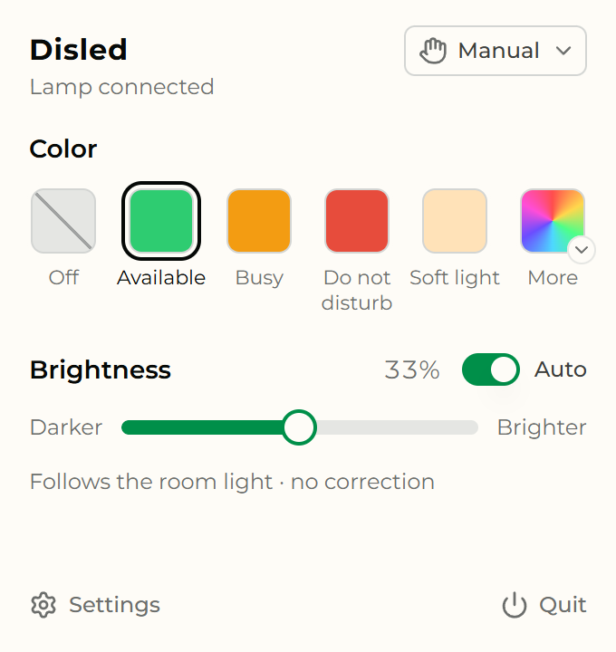
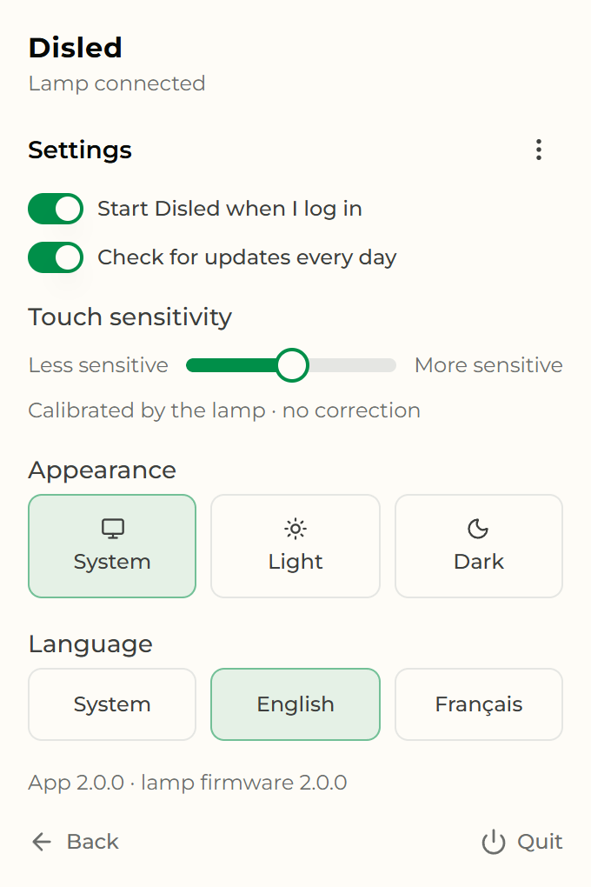
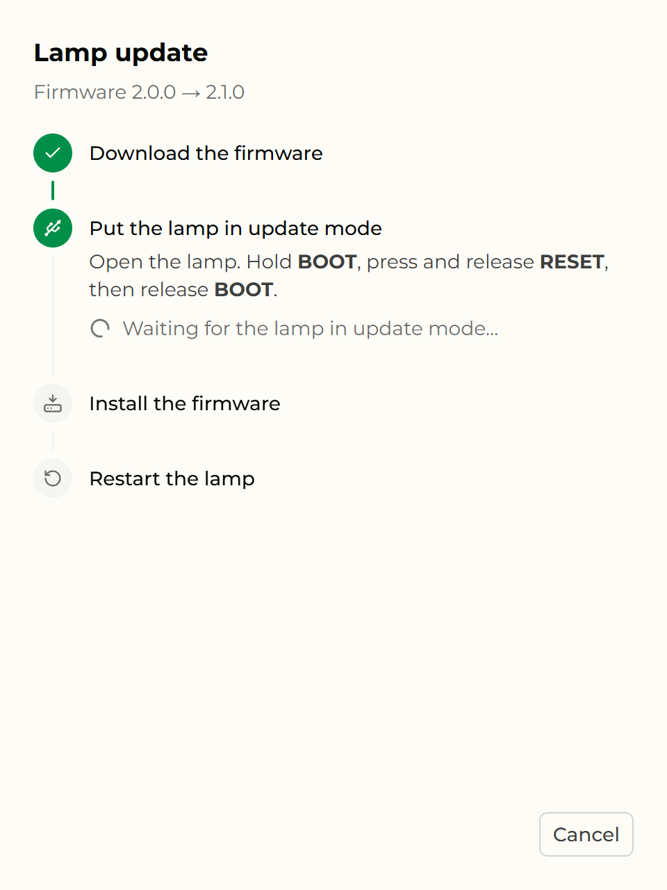
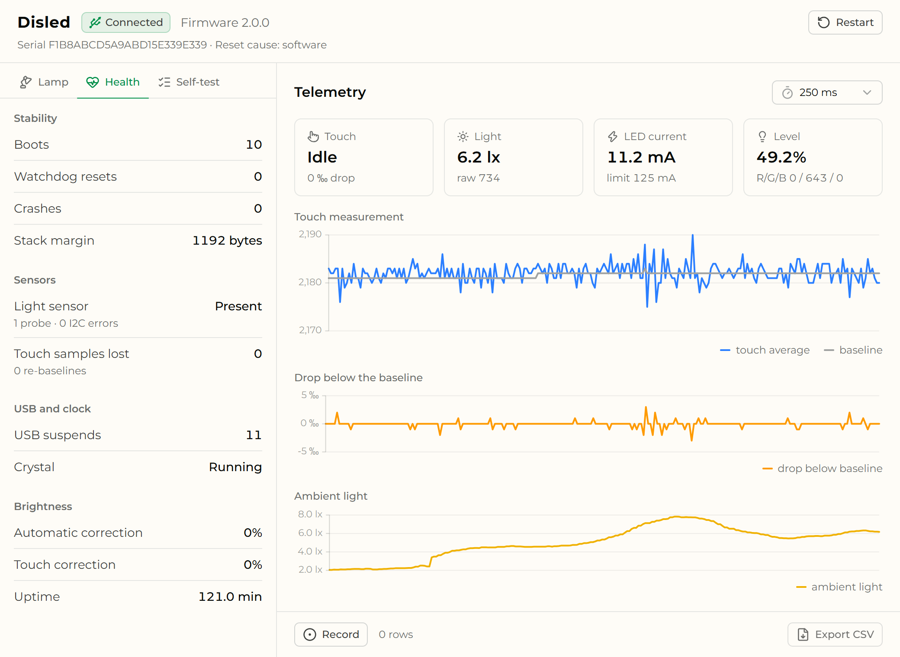

# Disled user guide

Disled is a 4 cm cube that glows in the color you choose: to show whether
you can be disturbed, to follow a program, or as a small light. This guide
covers everyday use: the lamp, its desktop app, the integrations and the
calls, the updates, and what to do when something goes wrong.

- [The lamp](#the-lamp)
- [Install the app](#install-the-app)
- [The tray icon](#the-tray-icon)
- [The popup](#the-popup)
- [Colors](#colors)
- [Integrations](#integrations)
- [Calls](#calls)
- [Updates](#updates)
- [Diagnostics](#diagnostics)
- [Troubleshooting](#troubleshooting)
- [Get help](#get-help)

## The lamp

Plug the lamp into your computer with a USB-C cable that carries data. A
charge-only cable lights the lamp, but the app cannot see it. The lamp
starts green, with its brightness following the room light.

**Colors.** The lamp has four colors of its own: green, orange, red and
warm white, named "Available", "Busy", "Do not disturb" and "Soft light"
until you rename them. The app adds up to five colors of yours
([Colors](#colors)).

**Touch.** The top of the cube is the touch surface:

| Gesture | Lamp on | Lamp off |
|---|---|---|
| Short touch | Next color of the touch cycle: green, orange, red, then green again, unless you chose other colors. A color outside the cycle goes to its first one. | Nothing |
| Hold for 2 s | Turns off, while your finger is still down | Turns on, in its last color |

An object laid on the top acts as one long touch, so the lamp turns off or
on after 2 s, then ignores the object. Take it away and the touch works
again.

While the lamp follows an integration, a short touch does nothing, and
holding for 2 s still turns it off or on ([Integrations](#integrations)).
While the lamp breathes for an alert, the touch does nothing at all.

**Brightness.** The lamp reads the room light through a small window on
the left side of its base, and dims or brightens within a second or two
when the room changes. In the dark it keeps a faint glow. Leave the window
uncovered.

**Without the app.** The lamp works on its own, with the touch and the
automatic brightness. When you quit the app, the lamp goes back to its four
colors, to the touch cycle green, orange, red, and to its own touch
sensitivity. If the app stops without quitting, as when it crashes, the
lamp keeps your colors and settings until it is unplugged, and its touch
works normally again after about 10 s. On a phone charger, or on a hub
with no computer, the lamp limits its power and is a little less bright at
the top of its range.

**Sleep.** When the computer sleeps, the lamp turns off. It comes back when
the computer wakes up.

At every power-up the lamp starts green, in automatic brightness. The app
then sends your colors and settings again ([Settings](#settings)).

## Install the app

Download the installer of your system from the
[latest release](https://github.com/Oui-Dev/Disled/releases/latest):

| System | File |
|---|---|
| Windows 10 and 11 | `Disled_X.Y.Z_x64-setup.exe` |
| macOS on Apple Silicon | `Disled_X.Y.Z_aarch64.dmg` |
| Debian, Ubuntu and derivatives | `Disled_X.Y.Z_amd64.deb` |

The installers carry no publisher certificate, so Windows and macOS warn
once:

- **Windows.** SmartScreen shows "Windows protected your PC". Click **More
  info**, then **Run anyway**.
- **macOS.** Drag Disled into Applications and open it. macOS refuses the
  first time: open System Settings, Privacy & Security, click **Open
  Anyway** next to the message about Disled, and confirm with your
  password.
- **Linux.** The package also installs a rule that lets you open the lamp
  without root rights. It applies at once, without unplugging the lamp.
  The calls need `libpulse0`, which most desktops have and the package
  recommends.

From then on the app starts with your session, unless you turn that setting
off. It lives in the notification area on Windows, the menu bar on macOS
and the tray on Linux. Only one copy runs, and starting it again opens the
popup. The app updates itself ([Updates](#updates)).

## The tray icon

The icon is a rounded square in the color of the lamp, an outline when the
lamp is off, and a faint outline when no lamp is connected.

- **Left click** opens or closes the popup.
- **Right click** opens a menu with **Open Disled**, **Diagnostics** and
  **Quit Disled**. On Linux the menu is the only way in, because the tray
  gives no clicks to the app.

On Windows the icon may land in the hidden icons, behind the **^** arrow of
the taskbar. Drag it onto the taskbar to keep it in view.

## The popup

<picture>
  <source media="(prefers-color-scheme: dark)" srcset="images/user-guide/popup-lamp-dark.png">
  
</picture>

- **Status.** "Lamp connected", "Connecting…" or "No lamp connected".
- **Mode.** The button at the top right says what the lamp follows:
  **Manual** when you choose its color, or the name of an integration
  ([Integrations](#integrations)).
- **Color.** **Off**, the four colors under your names, and **More**, which
  opens **My colors**: your own colors, **New** while you have fewer than
  five, and **Manage**, which leads to the [colors](#colors). The color the
  lamp shows has an outline, and **More** takes the look of your color
  when the lamp shows one.
- **During a call.** With **Microphone in use** on, a line under the colors
  ([Calls](#calls)).
- **Brightness.**
  - With **Auto** on, the lamp follows the room light, and the percentage
    next to the switch is the level it uses now. The slider shifts the
    automatic brightness, from **Darker** to **Brighter** (−50 to +50 %).
  - With **Auto** off, the slider sets a fixed level, from 1 to 100 %.
- **Settings** opens the settings page, **Quit** closes the app. When an
  update is on offer, **Settings** turns green, with a dot.

Without a lamp, the popup still takes your settings, and they apply when you
plug the lamp in. The popup hides when you click elsewhere or press Escape.

### Settings

<picture>
  <source media="(prefers-color-scheme: dark)" srcset="images/user-guide/popup-settings-dark.png">
  
</picture>

- **Start Disled when I log in**, **Check for updates every day**.
- **Touch sensitivity.** From **Less sensitive** to **More sensitive**
  (−50 to +50 %, in steps of 5 %). The lamp calibrates its touch by itself,
  and this shifts it. At +40 % and more, a hand held just above the lid may
  count as a touch, and can turn the lamp off.
- **Appearance.** System, Light or Dark.
- **Language.** System, English or Français.
- The versions of the app and of the lamp firmware, to give when you
  report a problem.
- The **⋮** button (More actions): **Check for updates**, **Open
  diagnostics**, **Reinstall the firmware**, and when the app last checked
  for updates.

The app keeps your settings on this computer: brightness, touch
sensitivity, your colors and the touch cycle, the calls and the
integrations. It sends what the lamp needs every time the lamp connects.
The app does not save the color and on/off, so the lamp always starts
green.

## Colors

**Manage** in **My colors** opens the **Colors** page:

- **The four colors of the lamp.** Their **⋮** menu has **Edit**, which
  renames them. Their shade stays: for another one, create a color.
- **Your colors**, up to five. **New color** adds one, and their **⋮** menu
  has **Edit** and **Delete**.
- **Touch.** The circles on the right say which colors a short touch steps
  through, and in which order. A click on an empty circle puts the color at
  the end of the cycle, a click on a number takes it out, and the next ones
  move up. The cycle keeps at least one color.
- **Share** ([below](#share-your-colors)).

**The editor.** A name of up to 16 characters, then the color: **Hue**,
from **Pale** to **Vivid**, a few suggestions, or a **Hex code**. With
**Preview on the lamp**, the lamp shows the color while you change it, and
gets its own back when you leave the editor. **Save** keeps it.

**Delete** acts at once, without a question. Wherever the color was in use,
another one takes its place: the first color of the touch cycle on the
lamp, "Do not disturb" for the calls, and the color an integration suggests
for its states.

The lamp keeps your colors only while the app runs: without the app, it
goes back to its four colors and its original cycle.

### Share your colors

**Share** opens **Share your colors**:

- **Send.** Your names, your colors and your touch cycle, in a code. **Copy
  the code**, then paste it in a message. The code never carries your
  settings.
- **Receive.** Paste the code you received into the field. A code that the
  app cannot read gives "Cannot read this code." Otherwise **Import these
  colors?** shows what it holds. **Import** replaces your names, your
  colors and your cycle.

## Integrations

An integration lets a program choose the color of the lamp, such as a tool
that shows whether it works or waits for you. Integrations come from
plugins, which people write for their programs
([how to write one](plugins.md)).

**The mode.** The button at the top right of the popup opens **The lamp
follows**: **Manual** ("You choose the color."), the **Calls** group, then
your integrations, one at a time, and **Manage integrations**. While the
lamp follows an integration:

- the row of colors gives way to **Off** and a card with the state the
  integration gives, such as what it does, and since when. A click on the
  card turns the lamp on with the color of that state;
- a short touch on the lid does nothing, and holding for 2 s still turns
  the lamp off or on;
- choose **Manual** to choose the color again.

**Manage integrations** opens the **Disled integrations** window:

- **Open the plugins folder** shows where the plugins live, one folder
  each. **Import a plugin** takes a plugin sent to you as a zip file.
- A new plugin arrives disabled. Turning it on asks "Enable …?" with what
  it will be able to do: choose the lamp color, make an alert, receive the
  events of its program, or run a program on this computer. Only enable
  plugins from people you trust. If its files change, Disled asks again.
- **Installation.** Some plugins come with a note: a block to add to the
  settings of their program, the address and the token already filled in.
  **Copy** puts it in the clipboard. Disled never changes the settings of
  another program: you paste the block yourself.
- **Colors.** The color the lamp takes for each state of the plugin.
- **Regenerate the token** gives the plugin a new one, to copy again into
  its program. **Remove the plugin** deletes its folder.

**Alerts.** A plugin allowed to may ask for an alert: the lamp breathes
three times, softly, then stops by itself. Nothing else shows in the popup.
There is no alert while the lamp is off, and the touch does nothing while
the lamp breathes.

## Calls

The lamp can take a color of your choice while you are in a call, in
manual mode. Turn on **Microphone in use**, under **Calls**, in the menu of
the mode button. A line then shows under the colors: **During a call: Do
not disturb**. A click on the color chooses another one.

An app that uses the microphone for 2 s starts a call, and 5 s without one
end it. During the call, the lamp shows the color of the calls, and the
line says **In a call · then Available**, the color the lamp gets back
after the call. Choose another color, or touch the lid, and your choice
stays until the end of the call. A lamp off stays off.

- Any app counts: Disled reads only whether the microphone is in use, never
  what it hears, and shows no app name.
- Muting yourself in a browser keeps the call, because the browser keeps
  the microphone open. Some apps release it when you mute, and the lamp
  then gets its color back.
- An app that listens all the time, for a wake word for instance, keeps
  the lamp in a call. Turn **Microphone in use** off, or that feature of
  the app.
- macOS needs version 14.2 or later, and Linux `libpulse0`. Without them,
  the **Calls** group does not show.

## Updates

### The app

The app looks for a new version when it starts, then once a day unless you
turn that off. When there is one, **Settings** turns green at the bottom of
the popup, and the settings page says "Disled X.Y.Z is available." with
**Install and restart**. The app then downloads the update, installs it and
starts again by itself, its popup open. Updates are signed, so the app
installs only versions published by the Disled project.

### The lamp

The app also looks for a newer lamp firmware. When there is one,
**Settings** turns green too, and the settings page says "Lamp firmware
X.Y.Z is available." with **Update**. If the app has an update too, the
settings page shows both: install the app first, because a new firmware may
need a new app. **Update** comes once the app is up to date.

<picture>
  <source media="(prefers-color-scheme: dark)" srcset="images/user-guide/lamp-update-dark.png">
  
</picture>

A window guides the update. It takes about a minute, and you will open the
lamp, because its update mode starts with two buttons on its board,
**BOOT** and **RESET**. Keep the lamp plugged in all along.

1. **Download the firmware.** The app downloads it and checks its
   signature.
2. **Put the lamp in update mode.** Open the lamp: pinch the cube at its
   grip stripes, over the clips, and lift it off its base. The touch ring
   inside the cube stays wired to the board, so lift gently. Hold
   **BOOT**, press and release **RESET**, then release **BOOT**.

   The first time on Windows, the window then asks for a driver for the
   update mode, once per computer. Download [Zadig](https://zadig.akeo.ie/)
   and run it. In **Options**, choose **List All Devices**, select the
   device whose USB ID is `4348 55E0` or `1A86 55E0`, choose **WinUSB**,
   then **Install Driver** or **Replace Driver**. The update goes on by
   itself once the driver is in place.
3. **Install the firmware.** The app erases the old one first. Do not
   unplug the lamp.
4. **Restart the lamp.** The app checks the version the lamp reports. Put
   the cube back on its base.

If the update stops, click **Try again**, or follow the
[flashing guide](flashing.md).

### Update required

A lamp that still runs firmware v1 cannot work with Disled v2. The popup
says "Update required", and everything that talks to the lamp is greyed
out: the colors, the mode button, the brightness, the touch sensitivity
and the diagnostics. **Update** under the message opens the same window as
above, and the lamp runs firmware v2 a minute later. The settings, the
languages, the app updates and **Reinstall the firmware** stay available.

### Reinstall the firmware

**Reinstall the firmware**, in the **⋮** menu of the settings page, opens a
window where you pick the version: the recommended one is checked, the one
the lamp runs is marked as current, and **Other versions** lists the older
ones. Each version links to its release notes. The window then guides the
install as above. It works with or without a lamp connected, so a lamp
that no longer starts gets its firmware back through its update mode.

**Back to firmware v1.** Version 1.0.0 is in the list too. Installed, it
makes the lamp work only with Disled v1. To go back to Disled v1 entirely,
do it in this order: first the lamp, with 1.0.0 from this window, then the
app, by installing Disled 1.1.2 by hand from its
[release](https://github.com/Oui-Dev/Disled/releases/tag/app-v1.1.2). In
the other order, Disled 1.1.2 would only offer the newest firmware. It will
then offer Disled v2 again: turn off **Check for updates every day** to
silence it.

## Diagnostics

<picture>
  <source media="(prefers-color-scheme: dark)" srcset="images/user-guide/diagnostics-dark.png">
  
</picture>

The Diagnostics window opens from the tray menu or from **⋮**, **Open
diagnostics**. You will not need it every day. It shows what the lamp
sees, and helps to report a problem.

- **Top.** The connection, the firmware version, the serial number and why
  the lamp last restarted. **Restart** restarts the lamp, which comes back
  green in a few seconds.
- **Lamp.** The controls of the popup. While the lamp follows an
  integration, the colors only turn it on and off.
- **Health.** The lamp's counters: restarts, crashes, light sensor, touch,
  USB sleeps, and both corrections. A badge on the tab shows when something
  needs a look.
- **Self-test.** The lamp shows red, green, blue and warm white, which you
  check, then glows blue. Touch the top within 10 s.
- **Telemetry.** Touch, light, LED current and level, live. **Record**,
  then **Export CSV**, saves the measurements to a file. The recording
  stays in the memory of the window until you export it, so closing the
  window, turning off the computer or a power cut loses it.

## Troubleshooting

| Symptom | What to do |
|---|---|
| "No lamp connected" | Use a cable that carries data, and plug the lamp into the computer or a powered hub. Right after the app starts, finding the lamp can take up to a minute on a computer with a USB device that answers slowly, such as some gaming mice. |
| "Update required" | The lamp still runs firmware v1: click **Update** ([Update required](#update-required)). |
| The tray icon is missing (Windows) | Look behind the **^** arrow of the taskbar, then drag the icon onto the taskbar. |
| The lamp turns off by itself | An object laid on the top turns it off after 2 s. At a high touch sensitivity, a hand held above the lid can too. |
| A short touch does nothing | The lamp follows an integration: hold for 2 s to turn it off or on, or choose **Manual** with the mode button. |
| The lamp stays in a call | An app keeps the microphone open, such as a browser tab or an assistant that waits for its wake word. Close it, or turn **Microphone in use** off. |
| The **Calls** group is missing | macOS needs version 14.2 or later, and Linux the `libpulse0` package. |
| An integration receives nothing | Check that its plugin is enabled and that its note was followed. A program that goes through a proxy must leave `127.0.0.1` out of it ([plugins.md](plugins.md#behind-a-proxy)). |
| Too bright or too dim in automatic mode | Move the slider toward **Brighter** or **Darker**, or turn **Auto** off for a fixed level. |
| The lamp turns off when the computer sleeps | This is expected. It comes back when the computer wakes up. |
| The lamp is dimmer on a phone charger | This is expected. Without a computer, it limits its power. |
| Lamp update: "Waiting for the lamp in update mode…" never ends | Check the button order (hold **BOOT**, press and release **RESET**, release **BOOT**), the driver on Windows, a cable that carries data, and that no other device is in update mode. |
| Lamp update: "The update stopped" | Click **Try again**. To flash by hand, see the [flashing guide](flashing.md). |
| The lamp stays dark after an update | Press **RESET**, or unplug the lamp and plug it back in. |

## Get help

Open an [issue](https://github.com/Oui-Dev/Disled/issues) with:

- the app and lamp firmware versions, from the settings page of the popup;
- your system (Windows, macOS or Linux) and its version;
- what you did, what happened, and what you expected;
- for a touch or light problem, a recording: in Diagnostics, **Record**,
  reproduce the problem, then **Export CSV** and attach the file.
